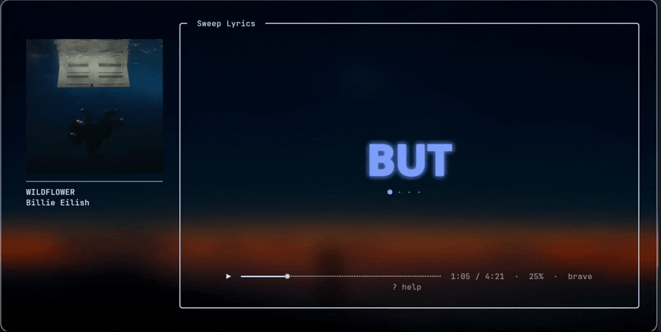
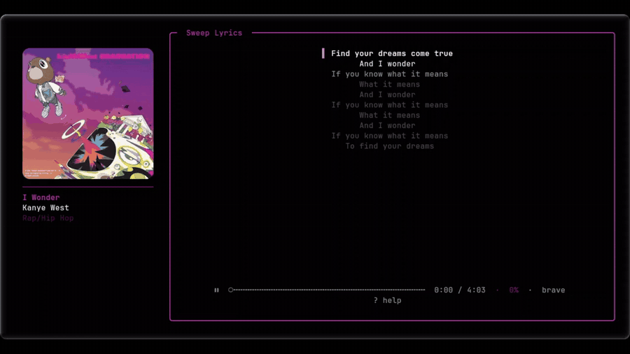

# Sweep Lyrics

Synced karaoke lyrics for the kitty terminal. Sweep Lyrics follows the MPRIS track and wipes a soft-edged highlight across each word in time with the vocal.

## 🎥 Preview

### Per-word mode



### Full lyrics



## ✨ Features

- Word-level karaoke wipe with a soft edge. Sweep Lyrics estimates syllable timing and calibrates it per song.
- Parallel lookup across Better Lyrics, Unison, LyricsPlus, KuGou, LRCLIB, and YouTube Music. Sweep Lyrics uses the first response.
- Per-word display (on by default) or the full lyric view, plus translation and romanization.
- Shazam mode: identify the track you hear and sync to it.
- Highlight color from your kitty theme.

## 📦 Install

This command installs the system packages on Arch, Debian/Ubuntu, and Fedora, then installs Sweep Lyrics with pipx:

```bash
curl -fsSL https://raw.githubusercontent.com/Nirune/sweep-lyrics/main/install.sh | bash
```

Read [install.sh](install.sh) before you run it. Pass `--no-optional` to skip the optional packages.

Open a new shell so `~/.local/bin` is on your `PATH`.

### 🛠️ Manual install

Install the packages for your distro, then Sweep Lyrics:

```bash
# Arch based
sudo pacman -S python-pipx kitty playerctl

# Debian / Ubuntu
sudo apt install pipx kitty playerctl

pipx ensurepath
pipx install git+https://github.com/Nirune/sweep-lyrics
```

Japanese romanization and the pronunciation dictionary:

```bash
pipx inject sweep-lyrics pykakasi cmudict
```

## 📋 Requirements

Required:

- Python 3.10 or newer. I develop on 3.14.
- kitty terminal
- An MPRIS player and `playerctl`

Optional. Sweep Lyrics detects these at runtime:

- `songrec`: Shazam mode (key `s`)
- `parec` or `pw-record` (`libpulse` / `pipewire`): capture audio for Shazam and sync
- `notify-send` (`libnotify`): desktop notification after Shazam identifies a song
- `fc-match` (fontconfig): locates a bold sans-serif font file
- `niri` or `xdotool`: find the focused window on niri or X11 so Sweep Lyrics can follow that player. Without them it follows the first player that is playing.

## 🎵 Supported players

Sweep Lyrics follows any player that exposes MPRIS and shows up in `playerctl`. Tested with:

- Spotify
- YouTube Music
- mpv (with the `mpv-mpris` plugin)
- YouTube Music or Spotify in the browser

Run `playerctl -l`. If your player is listed, Sweep Lyrics can follow it. Press `p` to cycle players when more than one is running.

## ⌨️ Usage

```bash
sweeplyrics
```

Keys:

- `space` play/pause
- `+` / `-` zoom
- `k` karaoke on/off
- `t` translation
- `y` romanization (needs pykakasi)
- `z` minimal mode (hides everything except play/pause and the progress bar)
- `m` search
- `f` alternate LRC
- `p` cycle to the next MPRIS player
- `s` Shazam mode (identify the playing track), `b` to leave it
- `h` Shazam identification history
- `[` / `]` shift sync earlier / later, saved per track
- `r` reset the sync offset
- `d` debug
- `o` settings
- `?` or `/` show the key bindings
- `q` quit

### Lyric animations

Pick a lyric animation:

| Animation | Description |
|-----------|-------------|
| `wipe` | Left-to-right karaoke wipe (default) |
| `dot` | One `●` sits above the sung word and arcs through a 2-row lane before each jump (1 row on a short terminal) |
| `bounce` | The sung word hops into a 1-row lane above the line, then lands as you hold the word |
| `none` | Static highlight |

Set `SWEEP_ANIMATION` to `wipe`, `dot`, `bounce`, or `none` before you start. That choice lasts for this run.

In settings (`o`), open **Lyric animation → Lyric style** and press `←` / `→`. **Layout → Mode** sets the arrangement: classic, bait, timeline, hud, or split. **Interface → Mode** switches the chrome: `standard` keeps the footer and the left cover, `dock` uses a bottom info strip.

Sweep Lyrics saves each setting by name and loads it on the next run. You see the active style in the footer, such as `anim:dot`, unless you left it on `wipe`.

## 🗑️ Uninstall

```bash
pipx uninstall sweep-lyrics
```

Lyrics history and Shazam results live in `~/.cache/sweep-lyrics`:

```bash
rm -rf ~/.cache/sweep-lyrics
```

## ⚙️ Environment variables

- `SWEEP_ANIMATION`: lyric animation (`wipe`, `dot`, `bounce`, `none`). Default `wipe`. Other values use `wipe`.
- `SWEEP_SHAZAM_DEVICE`: audio source for Shazam and sync. Default is the monitor of your current sink, from `pactl`. Example: `SWEEP_SHAZAM_DEVICE=alsa_output.xyz.monitor`
- `SWEEP_SMOOTH`: set to `0` for a hard karaoke cut. Default feathers the edge.
- `SWEEP_WORD_WIPE_SOFT`: set to `0` for a hard per-word wipe. Default feathers the edge.
- `SWEEP_IMG_SMOOTH`: set to `0` to turn off the soft edge on the kitty image wipe. Default feathers it.

## ⚠️ Disclaimer

Sweep Lyrics fetches lyrics at runtime from third-party services and does not bundle them. Several of those services expose unofficial or undocumented APIs, so a lookup can break and their terms may forbid this use. Rights holders keep the lyrics. You use this at your own risk.

## 🙏 Acknowledgements

Sweep Lyrics ships without lyrics. Each request pulls them live from the services below, and the lyrics stay with their owners.

- [LRCLIB](https://lrclib.net): free, open synced-lyrics database
- Better Lyrics, Unison, LyricsPlus, KuGou, and YouTube Music: extra sources, through unofficial public endpoints
- [songrec](https://github.com/marin-m/SongRec): Shazam-based track identification
- [playerctl](https://github.com/altdesktop/playerctl): MPRIS control
- [Rich](https://github.com/Textualize/rich), [pykakasi](https://github.com/miurahr/pykakasi), [cmudict](https://github.com/prosegrinder/python-cmudict): rendering, Japanese romanization, and pronunciation data, each under its own license
- [Dux Shell](https://github.com/duxlabs-dev/dux-shell) (MIT): the multi-provider lookup and the soft-edge wipe started here

Those endpoints are unofficial and can break. None of these services are affiliated with Sweep Lyrics.

## 👤 Author

[@Nirune](https://github.com/Nirune).

Claude (Anthropic), ChatGPT (OpenAI), and Grok (xAI, for the UI) helped. I decide what ships, and I test it myself.

## 📄 License

MIT
