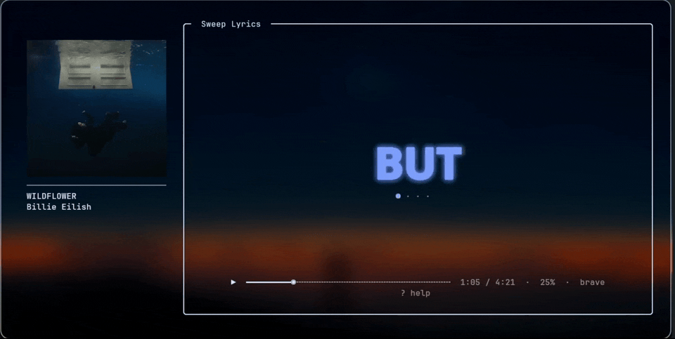

# Sweep Lyrics

Synced karaoke lyrics for the kitty terminal. Follows the track playing over MPRIS and sweeps a soft-edged highlight across each word as it is sung.

## ✨ Features

- Word-level karaoke wipe with a soft edge, with per-syllable timing estimated and calibrated per song
- Several lyrics sources raced in parallel: Better Lyrics, Unison, LyricsPlus, KuGou, LRCLIB, YouTube Music
- Per-word display mode (on by default) or classic full-lyrics view, live translation, romanization
- Shazam mode: identify the track that is actually playing and sync to it
- Highlight color follows your kitty theme

## 📦 Install

One command. It installs the system dependencies for Arch, Debian/Ubuntu and Fedora families, then installs Sweep with pipx:

    curl -fsSL https://raw.githubusercontent.com/Nirune/sweep-lyrics/main/install.sh | bash

Prefer to read it first: [install.sh](install.sh). Pass `--no-optional` to skip the optional packages.

Open a new shell afterwards so `~/.local/bin` is on your `PATH`.

### 🛠️ Manual install

Install the required packages for your distro, then Sweep itself:

    # Arch based
    sudo pacman -S python-pipx kitty playerctl

    # Debian / Ubuntu
    sudo apt install pipx kitty playerctl

    pipx ensurepath
    pipx install git+https://github.com/Nirune/sweep-lyrics

Optional extras (Japanese romanization, pronunciation dictionary):

    pipx inject sweep-lyrics pykakasi cmudict

## 📋 Requirements

Required:

- Python 3.10 or newer (developed on 3.14)
- kitty terminal
- An MPRIS player and `playerctl`

Optional (detected at runtime):

- `songrec`: Shazam mode (key `s`)
- `parec` or `pw-record` (`libpulse` / `pipewire`): audio capture for Shazam and sync
- `notify-send` (`libnotify`): desktop notification when Shazam identifies a song
- `fc-match` (fontconfig): locates a bold sans-serif font file
- `niri` or `xdotool`: focused-window lookup on niri / X11, used to pick the matching player (falls back to the first playing one)

## ⌨️ Usage

    sweeplyrics

Keys:

- `space` play/pause
- `+` / `-` zoom
- `k` karaoke on/off
- `t` translation
- `y` romanization (needs pykakasi)
- `z` minimal mode (hides everything except play/pause and the progress bar)
- `m` search
- `f` alternate LRC
- `p` cycle to the next MPRIS player (when more than one is running)
- `s` Shazam mode (identify the playing track), `b` to leave it
- `h` Shazam identification history
- `[` / `]` shift sync earlier / later, remembered per track
- `r` reset the sync offset
- `d` debug
- `o` settings
- `?` or `/` show all key bindings
- `q` quit

Settings are saved between runs, so anything you toggle (including per-word mode) stays as you left it.

## 📁 Files

- Config: `~/.config/sweep-lyrics/lyrics-providers.json` (provider order and enabled sources)
- Cache and state: `~/.cache/sweep-lyrics/`

## ⚙️ Environment variables

- `SWEEP_SHAZAM_DEVICE`: audio source used for Shazam and sync. Defaults to the monitor of your current default sink (via `pactl`); set it if you want a specific one, e.g. `SWEEP_SHAZAM_DEVICE=alsa_output.xyz.monitor`
- `SWEEP_IMG_SMOOTH`
- `SWEEP_SMOOTH`
- `SWEEP_WINDOW`
- `SWEEP_WORD_WIPE_SOFT`

## ⚠️ Disclaimer

Lyrics are fetched at runtime from third-party services and are never bundled with this project. Several of those services expose unofficial or undocumented APIs, so lookups can break at any time and their terms of service may not allow this kind of use. Lyrics remain the property of their rights holders. Use at your own risk.

## 🙏 Acknowledgements

Sweep does not bundle any lyrics. It looks them up at runtime from these services; all lyrics belong to their respective rights holders.

- [LRCLIB](https://lrclib.net): free, open synced-lyrics database
- Better Lyrics, Unison, LyricsPlus, KuGou and YouTube Music: additional lyric sources, through their unofficial public endpoints
- [songrec](https://github.com/marin-m/SongRec): Shazam-based track identification
- [playerctl](https://github.com/altdesktop/playerctl): MPRIS control
- [Rich](https://github.com/Textualize/rich), [pykakasi](https://github.com/miurahr/pykakasi), [cmudict](https://github.com/prosegrinder/python-cmudict): rendering, Japanese romanization and pronunciation data, each under its own license
- [Dux Shell](https://github.com/duxlabs-dev/dux-shell) (MIT): inspiration for the multi-provider lookup and the soft-edge wipe

The unofficial endpoints are not affiliated with Sweep and can change or stop working at any time. Sweep is not affiliated with YouTube, Shazam or any other service named here.

## 👤 Author

Created and maintained by [@Nirune](https://github.com/Nirune).

Sweep is built with AI assistance from Claude (Anthropic), ChatGPT (OpenAI) and Grok (xAI, used for the UI design). Direction, testing and final decisions are by the author.

## 📄 License

MIT
